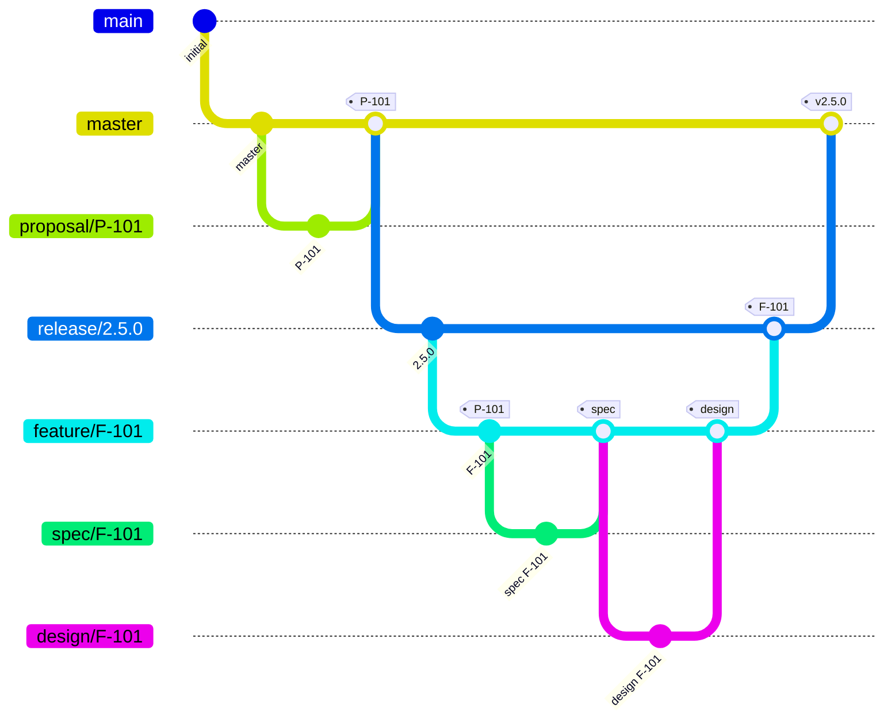

# Разработка, основанная на спецификациях
Описание подхода к разработке программного обеспечения с использованием искусственного интеллекта

## Известные ограничения
1. Уже формализован и согласован шаблон бизнес требований, который является обязательным артефактом и проверяется на этапе ПСИ
2. Спецификации должны хранится в репозитории GIT
3. Формат и состав артефактов должен соответствовать одному из одобренных 
4. Контекстное окно ИИ агента ограничено 262 тыс. токенов

## Артефакты и их назначение
- **Предложение**: Описывает то, что хотим сделать, зачем это нужно, какую ценность принесёт и как эту ценность измерить.
- **Требование**: Описывает требование регулятора или надзорного органа которое обязательно к выполнению.
- **Спецификация**: Описывает то, что система должна уметь, чтобы полностью или частично удовлетворить «предложение» или «требование».
- **Техническое решение**: Описывает то, как технически система будет обеспечивать выполнение требований «спецификации».
- **Возможность**: Описывает существующую возможность системы в виде программных интерфейсов.

### Авторы артефактов
- Если система функционирует согласно спецификации, но в спецификации не предусмотрены какие-то сценарии, из-за чего система функционирует некорректно – ответственность на аналитике.
- Если реализация не удовлетворяет требованиям спецификации – ответственность на архитекторе или техническом лидере.
- Если система функционирует корректно, реализация полностью удовлетворяет требованиям спецификации, но «ценность» не достигается – ответственность на заказчике.

Таким образом, автором артефакта должен быть тот, кто несёт ответственность за последствия принятых в нём решений.

## Команды для агента
- `/requirement <artifact-id>`: Запускает процесс оформления требования
- `/proposal <artifact-id>`: Запускает процесс оформления предложения
- `/spec <artifact-id>`: Запуская процесс создания спецификации
- `/spec-nfr`: Запуская процесс создания нефункциональных требований для текущей спецификации
- `/design <spec-id>`: Запускает процесс создания технического решения
- `/update <artifact-id>`: Запускает процесс исправления замечаний рецензентов
- `/advice`: Запускает независимого агента рецензента для критической оценки текущего артефакта
- `/submit`: Отправляет локальные изменения в репозиторий и возвращает ссылку для создания запроса на слияние

Команды запускаются единообразно: косая черта + название + опционально аргументы, но на уровне окружения могут быть реализованы по разному:
- `skill`: Навык который активируется в текущей сессии
- `agent`: Под-агент с собственной системной инструкцией и доступными инструментами
- `command`: Обычная команда, которая активирует навык или под-агента 
- `workflow`: Не поддерживается текущей версией GigaCode, но будет доступен в будущем

## Процесс
### Шаг 1 - Предложение или Требование
Каким-то образом возникает «предложение» или «требование»: письмо на почту, сообщение в чате, стенография встречи и т.д. Аналитик фиксирует его в виде соответствующего артефакта:
1. Запускает команду `/proposal` или `/requirement`;
2. Агент запрашивает черновик и проводит интервью, пока не получит ответы на обязательные вопросы;
3. Агент оформляет предварительную версию и вызывает команду `/advice`;
4. Независимый агент рецензирует, и возвращают на доработку пока не останется замечаний;
5. Агент запрашивает рецензию у аналитика;
6. Аналитик рецензирует, агент дорабатывает пока не останется замечаний;
7. Готовый артефакт записывается в директорию `/proposals` или `/requirements`;
8. Когда замечаний больше нет, аналитик вызывает команду `/submit`;
9. Открывает ссылку, создает запрос на слияние и добавляет рецензентов: коллегу аналитика, заказчика и других интересантов;
10. Завершает текущую сессию, чтобы освободить контекст;

Когда каждый рецензент дал обратную связь – одобрил или отклонил, то: если у рецензентов нет замечаний – делает слияние, если есть:
1. Запускает новую сессию; 
2. Вызывает команду `/update <artifact-id>`; 
3. Агент читает замечания рецензентов, предлагает/вносит правки; 
4. Агент запрашивает рецензию у аналитика; 
5. Аналитик рецензирует, агент дорабатывает пока не останется замечаний; 
6. Когда замечаний больше нет, аналитик вызывает команду `/submit`;
7. Завершает текущую сессию, чтобы освободить контекст.

Процесс повторяется пока все рецензенты не одобрят запрос.

### Шаг 2 - Спецификация
Когда предложение или требование одобрено, аналитик приступает к формированию спецификации:
1. Запускает команду `/spec`;
2. Агент запрашивает номер предложения или требования для которого создается спецификация;
3. Агент собирает список спецификаций, на которых реализация _текущей_ может повлиять;
4. Агент формирует список сценариев, то есть то, как система должна реагировать на возникновение какого-то события: `Когда -> Тогда` с учетом информации полученной от специализированного агента;
5. Агент оформляет предварительную версию и вызывает команду `/advice`;
6. Независимый агент рецензирует, и возвращают на доработку пока не останется замечаний;
7. Агент запрашивает рецензию у аналитика;
8. Аналитик рецензирует, агент дорабатывает пока не останется замечаний;
9. Готовый артефакт записывается в директорию `/features/<feature-name>/spec.md`; 
10. Когда замечаний больше нет, аналитик вызывает команду `/spec-nfr`; 
11. Агент проводит интервью и собирает список нефункциональных требований;
12. Агент запрашивает рецензию у аналитика;
13. Аналитик рецензирует, агент дорабатывает пока не останется замечаний;
14. Когда замечаний больше нет, агент оценивает сам, и дополнительно уточняет у аналитика: полностью ли текущая спецификация покрывает предложение/требование?
    1. Если да, агент переносить файл с предложением/требованием в директорию `/proposals/archive` или `/requirements/archive`;
    2. Если нет, файл с предложением/требованием остается в директории `/proposals` или `/requirements`.
15. После этого, аналитик вызывает команду `/submit`; 
16. Открывает ссылку, создает запрос на слияние и добавляет рецензентов: коллегу аналитика, тестировщика и архитектора, технического лидера или разработчика; 
17. Завершает текущую сессию, чтобы освободить контекст.

Когда каждый рецензент дал обратную связь – одобрил или отклонил, то: если у рецензентов нет замечаний – делает слияние, если есть:
1. Аналитик вызывает команду `/update <spec-id>`;
2. Агент читает замечания рецензентов из GIT, предлагает/вносит правки;
3. Агент запрашивает рецензию у аналитика;
4. Аналитик рецензирует, агент дорабатывает пока не останется замечаний;
5. Когда замечаний больше нет, аналитик вызывает команду `/submit`;
6. Завершает текущую сессию, чтобы освободить контекст.

Процесс повторяется пока все рецензенты не одобрят запрос.

### Шаг 3 – Техническое решение
Когда спецификация одобрено, архитектор, технический лидер или разработчик приступает к формированию технического решения:
1. Запускает команду `/design`;
2. Агент собирает список существующих программных интерфейсов, на которые текущее техническое решение может полагаться или повлиять;
3. Агент оформляет предварительную версию решения и вызывает команду `/advice`;
4. Независимый агент рецензирует, и возвращают на доработку пока не останется замечаний;
5. Агент запрашивает рецензию у человека;
6. Человек рецензирует, агент дорабатывает пока не останется замечаний;
7. Готовый артефакт записывается в директорию `/features/<feature-name>/design.md`; 
8. Агент обновляет соответствующие программные интерфейсы в директории `/abilities/<ability>/<contract>.<ext>` дельтой из спецификации, или создает новые; 
9. Когда замечаний больше нет, человек вызывает команду `/submit`; 
10. Открывает ссылку, создает запрос и добавляет рецензентов: аналитика, тестировщика и разработчиков которые будут это реализовывать; 
11. Завершает текущую сессию, чтобы освободить контекст;

Когда каждый рецензент дал обратную связь – одобрил или отклонил, то: если у рецензентов нет замечаний – делает слияние, если есть:
1. Вызывает команду `/update <spec-id>`;
2. Агент читает замечания рецензентов из GIT, предлагает/вносит правки;
3. Агент запрашивает рецензию у человека;
4. Человек рецензирует, агент дорабатывает пока не останется замечаний;
5. Когда замечаний больше нет, человек вызывает команду `/submit`;
6. Завершает текущую сессию, чтобы освободить контекст.

Процесс повторяется пока все рецензенты не одобрят запрос.

### Шаг 4 - Реализация
Разработчик один раз подключает репозиторий спецификаций как подмодуль GIT.

Когда спецификация и техническое решение приняты и согласованы, разработчик приступает к реализации:
1. Отводит ветку `/feature/<spec-id>`;
2. Реализовывает.

Разработчик использует собственный инструментарий: набор навыков, агентов, команд или системных инструкций.

## Ветвления в репозитории спецификаций
### Ветки
- `master` — Содержит спецификации того, что сейчас находится в промышленной эксплуатации, и все оформленные «предложения» и «требования»;
- `release/<version>` — Содержит _одно_ из следующих состояний промышленной среды. Вливается в `master` после ввода в эксплуатацию;
- `proposal/<proposal-id>` — Ветвится от `master`, вливается в `master`;
- `feature/<feature-id>` — Ветвится от `release` с тегом `<proposal-id>`, вливается в `release/<version>`;
- `spec/<feature-id>` — Ветвится от `feature/<feature-id>`, вливается обратно в ту же `feature`;
- `design/<feature-id>` — Ветвится от `feature/<feature-id>`, вливается обратно в ту же `feature`.

### Диаграмма

### Процесс
#### Proposal
1. Ветка `proposal/<id>` отводится от `master`;
2. Работа ведётся в `proposal/<id>`;
3. Команда `/submit` создаёт запрос на слияние в `master`;
4. Доработка после ревью через `/update <artifact-id>` в той же ветке, и повторный `/submit`;
5. После одобрения вливается в `master`.

Предложение или требование – это не спецификация. В репозитории этот артефакт просто фиксируется, чтобы спецификации на него ссылались.

#### Feature
1. Ветка `feature/<feature-id>` отводится от `master` которая содержит текущий эксплуатируемый релиз;
2. Запрос на слияние создается в нужную `release/<version>` вручную – релиз-менеджером;
3. После одобрения вливается в `release/<version>`.

Ветка `feature/<feature-id>` это контейнер для вливания спецификации: `spec/<feature-id>`, и технического решения: `design/<feature-id>`, которые должны быть одобрены по отдельности.
Так как команда `/design` также актуализирует программные интерфейсы в директории `/abilities`, то на этапе слияния могут, теоретически, возникнуть конфликты.
Они разрешаются командой `/update <artifact-id>` в ветке `design/<feature-id>` и повторным запросом на слияние в `feature/<feature-id>`.

#### Spec
1. Ветка `spec/<feature-id>` отводится от `feature/<feature-id>`;
2. Работа ведётся в `spec/<feature-id>`;
3. Команда `/submit` создаёт запрос на слияние в `feature/<feature-id>`;
4. Доработка после ревью через `/update <artifact-id>` в той же ветке, и повторный `/submit`;
5. После одобрения вливается в `feature/<feature-id>`.

#### Design
1. Ветка `design/<feature-id>` отводится от `feature/<feature-id>`;
2. Работа ведётся в `design/<feature-id>`;
3. Команда `/submit` создаёт запрос на слияние в `feature/<feature-id>`;
4. Доработка после ревью через `/update <artifact-id>` в той же ветке, и повторный `/submit`;
5. После одобрения вливается в `feature/<feature-id>`.