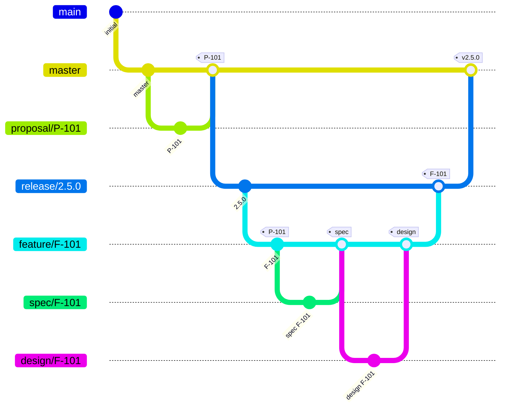

## Предложение
Ценность есть всегда, и всегда измерима хоть в чем-нибудь – без исключений.


## Функция
После рассмотрения «предложения» появляется одна функця, если она может полностью удовлетворить предложение, или несколько функций.  
Функция состоит из двух обязательных артефактов:

### Спецификация
То, что система должна уметь делать, чтобы полностью или частично удовлетворяющее предложение.

### Техническое решение
То каким именно образом обеспечить выполнение требований спецификации.
Принимается компетентной ролью полагаясь том числе на уже существующие «возможности» и на контракты взаимодействия с внешними системами.
Техническое решение не рождается пока нет спецификации.

## Возможность
Проектирование технического решения порождает возникновение «возможности», которая естественным образом расширяется при появлении связанных функций.
Возможность состоит исключительно из контракта – OpenAPI, AsyncAPI, Protobuf и пр., а техническое решение описывает дельту.


```
/openspec
    /proposals
        <pending-proposal>.md
        /archive
            <released-proposal>.md
    /requirements
        <pending-requirement>.md
        /archive
            <released-requirement>.md
    /features
        /<feature>
            spec.md
            design.md
    /abilities
        /<ability>
            context.md?
            <openapi|asyncapi|protobuf>.<ext>
```

Что спецификация описывает:
- Ожидаемое поведение системы, то есть как система реагирует на то или иное событие. Примеры:
    - При получении события «А» из внешней системы «Х», система должна пересчитать стоимость всех заказов, и:
        - Если пользователь с ролью «М» смотрит историю заказов пользователя «Ч», то показать ему уведомление о том, что данные изменились, и дать возможность их обновить;
        - Пересчитать стоимость всех заказов, и отправить событие в систему «К»
- Что система должна обеспечивать потребителю – пользователю или другой системе. Примеры:
    - Не показывать свойство «А» ролям «Б» и «Д»;
    - Позволять фильтровать заказы по полям «Г», «Ф», времени создания и статусу;
    - Позволять выгрузить историю действий пользователя за последние 30 дней;
- Контракты взаимодействия с внешними системами. Такой контракт это свершийвшиеся факт, он не проектируется, но учитывается при формировании следующего артефакта: технического решения.
- Цифры: RPS, TTL, срок жизни/хранения чего либо
  Компетентная роль предусматривает и описывает все сценарии. Спецификация должна предусматривать «реакцию» системы на любое действие или событие.

Что спецификация не описывает:
- То, как с точки зрения ПО, система выполнит требования. В спецификации нет, и не должно быть (за исключение контрактов взаимодействия с внешними системами):
    - Схем, названия колонок, структур или типов БД;
    - Схем OpenAPI, AsyncAPI, Protobuf или любые другие «контракты»;
    - Названий топиков, эндпоинтов, коды ошибок;
    - Протоколы передачи данных;
    - Состав и протокол передачи данных между разными компонентами системы.
      Подходящий тип БД, технологию, протокол и формат передачи данных выбирает компетентная роль при формировании технического решения исходя из того, какие требования ему нужно выполнить.


После того как техническое решение принято и оформлено, выполняется команда `/design`:
- Агент ищет связанные возможности, далее:
    - Если возможность уже есть, применяет дельту: обновляет контракты и диаграмы взаимодействия
    - Если нет, создает контракты и диаграмы взаимодействия
- Адвисоры рецензируют, и возвращают на доработку пока не останется замечаний;
- Компетентное лицо рецензирует, агент дорабатывает пока не останется замечаний;
- По завершению, окружение само делает ПР;
- После того, как ПР получил апрувы, артефакт технического решения появляется в `/features` основной ветки

После появления согласованной спецификации, можно приступать к написанию тестов, не дожидаясь технического решения.


## Ветвления в репозитории спецификаций
### Ветки
- `master` — Содержит спецификации того, что сейчас находится в промышленной эксплуатации, и все оформленные «предложения» и «требования»;
- `release/<version>` — Содержит _одно_ из следующих состояний промышленной среды. Вливается в `master` после ввода в эксплуатацию;
- `proposal/<proposal-id>` — Ветвится от `master`, вливается в `master`;
- `feature/<feature-id>` — Ветвится от `release` с тегом `<proposal-id>`, вливается в `release/<version>`;
- `spec/<feature-id>` — Ветвится от `feature/<feature-id>`, вливается обратно в ту же `feature`;
- `design/<feature-id>` — Ветвится от `feature/<feature-id>`, вливается обратно в ту же `feature`.

### Механика
#### Proposal 
## Короткоживущие ветки
- `proposal/<proposal-id>` — Ветвится от master, сливается в master.
- `feature/<feature-id>` — Ветвится от `release` с тегом `proposal=<proposal-id>`. Это интеграционная ветка для спецификации и технического решения:
  - `spec/<feature-id>` — Ветвится от `feature/<feature-id>` только если оно содержит тег `proposal=<proposal-id>`, сливается обратно в `feature`;
  - `design/<feature-id>` — Ветвится от `feature/<feature-id>` только если в нее слита ветка `spec/<feature-id>`. Сливается обратно в `feature`

Ветка `feature/<feature-id>` сливается в релиз, только если содержит тег `proposal=<proposal-id>` и слитые `spec/<feature-id>` и `design/<feature-id>`.


### Шаг 0 — Proposal

1. Ветка `proposal/<id>` создаётся от `master`.
2. Работа ведётся в `proposal/<id>`.
3. `/submit` создаёт PR #0 в `master`.
4. Ревью, доработка через `/update <artifact-id>` в той же ветке, повторный `/submit`.
5. После апрува — merge в `master`. Proposal получает входящий номер.

### Шаг 1 — Рождение feature-ветки

1. Сразу после merge proposal в `master` создаётся ветка `feature/<id>` от `master`.
2. Ветка пустая — содержит только историю master, включая proposal.
3. В описании ветки фиксируется ссылка на `proposal/<id>`.
4. Если из одного proposal возникает несколько фич — создаётся несколько независимых `feature/<id-1>`, `feature/<id-2>`.

### Шаг 2 — Spec

1. Ветка `spec/<id>` создаётся от `feature/<id>`.
2. Работа ведётся в `spec/<id>`.
3. `/submit` создаёт PR #1 в `feature/<id>`.
4. Ревью, доработка через `/update <spec-id>` в той же ветке, повторный `/submit`.
5. После апрува — merge в `feature/<id>`.
6. Ветка `spec/<id>` закрывается.

### Шаг 3 — Design

1. Ветка `design/<id>` создаётся от `feature/<id>` (где spec уже смержена).
2. Работа ведётся в `design/<id>`.
3. `/submit` создаёт PR #2 в `feature/<id>`.
4. Ревью, доработка через `/update <spec-id>` в той же ветке, повторный `/submit`.
5. После апрува — merge в `feature/<id>`.
6. Ветка `design/<id>` закрывается.

### Шаг 4 — Feature → Release

1. Когда spec и design обе смержены в `feature/<id>`, ветка готова к включению в релиз.
2. `/submit` создаёт PR #3 в `release/<version>`.
3. Ревью (release manager, архитектор), доработка через `/update <feature-id>` в той же ветке, повторный `/submit`.
4. После апрува — merge в `release/<version>`.
5. Один PR содержит и спецификацию, и техническое решение.
6. Ветка `feature/<id>` закрывается.

### Шаг 5 — Release → Master

1. После стабилизации релиза `release/<version>` мержится в `master`.
2. Проставляется тег `v<version>`.
3. Релизная ветка закрывается (или остаётся для hotfix).

### Шаг 6 — Hotfix

1. Ветка `hotfix/<id>` создаётся от `master`.
2. Работа ведётся в `hotfix/<id>`.
3. `/submit` создаёт PR в `master`.
4. После апрува — merge в `master`.
5. Ветка `hotfix/<id>` мержится также в актуальную `release/<version>` (и/или в открытые feature-ветки, если затронуты), чтобы правка не потерялась при следующем релизе.





## Финальная модель ветвления

**Валидация:**
- В окружении (агент) — предусловия перед созданием ветки/PR.
- В CI — на каждом PR (формат, ссылки, наличие предка, чек-лист готовности feature к release).

**Открытые договорённости (не автоматизируются):**
- Роль и полномочия release manager.
- Чек-лист готовности feature к release.
- Правило устаревания feature-ветки.
- Что делать с proposal, если из него несколько feature и не все реализованы (архивация).
- Обработка ситуации «spec готова, design нет» — feature не мержится в release (атомарность).

